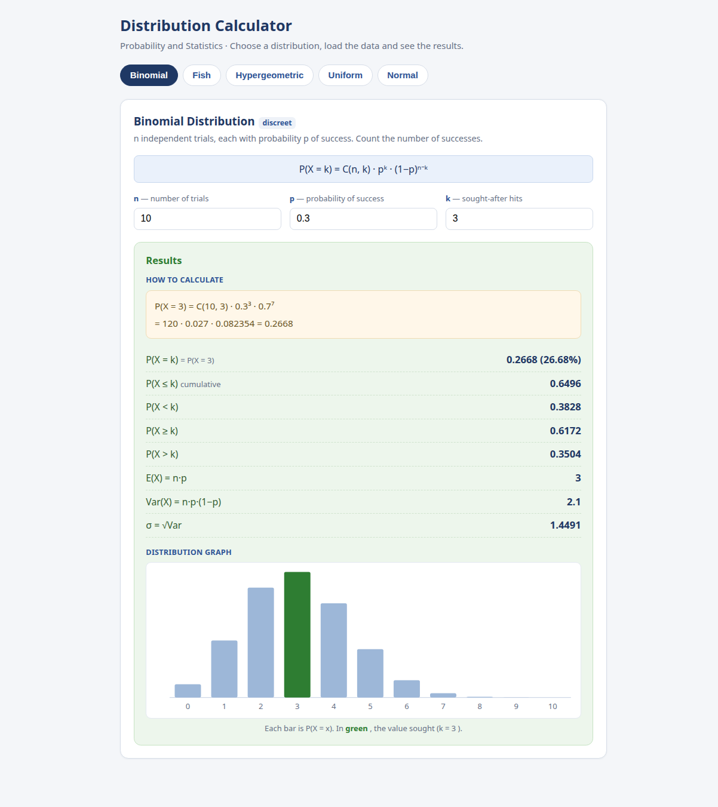

# Probability Distributions Calculator

An interactive web-based calculator for computing probabilities, expected values, and visualizing common probability distributions used in university statistics courses.

[](https://candeladengra.github.io/calculadora-distribuciones/)



## Features

- **Interactive Calculations**: Real-time computation of probability values as you adjust parameters
- **Step-by-Step Solutions**: Detailed substitution steps showing how results are calculated
- **Visual Charts**: Dynamic bar charts and distribution curves for each distribution
- **Comprehensive Metrics**: Calculates probabilities, cumulative distributions, expected values, variance, and standard deviation
- **Clean, Modern UI**: Responsive design with intuitive controls and clear visual feedback

## Supported Distributions

### Discrete Distributions

- **Binomial**: Models *n* independent trials with probability *p* of success
  - Calculates: P(X = k), P(X ≤ k), P(X < k), P(X ≥ k), P(X > k)
  - Parameters: n (trials), p (success probability), k (target successes)

- **Poisson**: Models rare events occurring at a constant average rate
  - Calculates: P(X = k), cumulative probabilities, expected value
  - Parameters: λ (rate), k (number of events)

- **Hypergeometric**: Models sampling without replacement from finite populations
  - Calculates: P(X = k), cumulative probabilities, expected value
  - Parameters: N (population size), K (success states in population), n (draws), k (observed successes)

### Continuous Distributions

- **Uniform**: Models equally likely outcomes over a continuous interval
  - Calculates: P(X < x), P(X > x), P(a < X < b)
  - Parameters: a (minimum), b (maximum), x values

- **Normal**: The classic bell curve, fundamental to statistics
  - Calculates: Z-scores, P(X < x), P(a < X < b), standardized probabilities
  - Parameters: μ (mean), σ (standard deviation), x values

## Calculations Provided

For each distribution, the calculator computes:

- **Probability Mass/Density Functions**: Exact probability for specific values
- **Cumulative Distribution Functions**: P(X ≤ k) and related probabilities
- **Expected Value (E[X])**: The mean of the distribution
- **Variance (Var[X])**: Measure of spread
- **Standard Deviation (σ)**: Square root of variance
- **Visual Representations**: Bar charts for discrete distributions, shaded regions for continuous distributions

## Technology Stack

- **React 18.3.1**: UI framework
- **ReactDOM 18.3.1**: React rendering
- **Vanilla JavaScript**: Mathematical computations
- **CSS3**: Custom styling with CSS variables
- **Single-file HTML**: Self-contained application with no external dependencies

## Running Locally

1. Clone this repository:
   ```bash
   git clone https://github.com/candeladengra/calculadora-distribuciones.git
   cd calculadora-distribuciones
   ```

2. Open the HTML file directly in your browser:
   ```bash
   open index.html
   ```
   
   Or simply double-click `index.html` in your file explorer.

No build process, dependencies, or web server required—just open and use!

## Use Case

This calculator was built as an educational tool for **Probability and Statistics** courses. It's designed to help students:

- Verify homework calculations
- Understand probability distributions through visualization
- Learn the relationship between parameters and outcomes
- See step-by-step calculation processes

---

## Versión en español

**Calculadora de Distribuciones de Probabilidad** — Una calculadora web interactiva para resolver problemas de probabilidad y visualizar distribuciones estadísticas comunes en cursos universitarios.

### Características principales

- Cálculo en tiempo real de probabilidades y estadísticos
- Visualización con gráficos de barras y curvas
- Paso a paso de las sustituciones y cálculos
- Cinco distribuciones: Binomial, Poisson, Hipergeométrica, Uniforme y Normal
- Interfaz limpia y moderna, sin necesidad de instalación

### Uso

Abrí `index.html` directamente en tu navegador. No requiere servidor web ni dependencias.

---

## License

This project is open source and available for educational use.

## Author

Created by [Candela Dengra](https://github.com/candeladengra)
